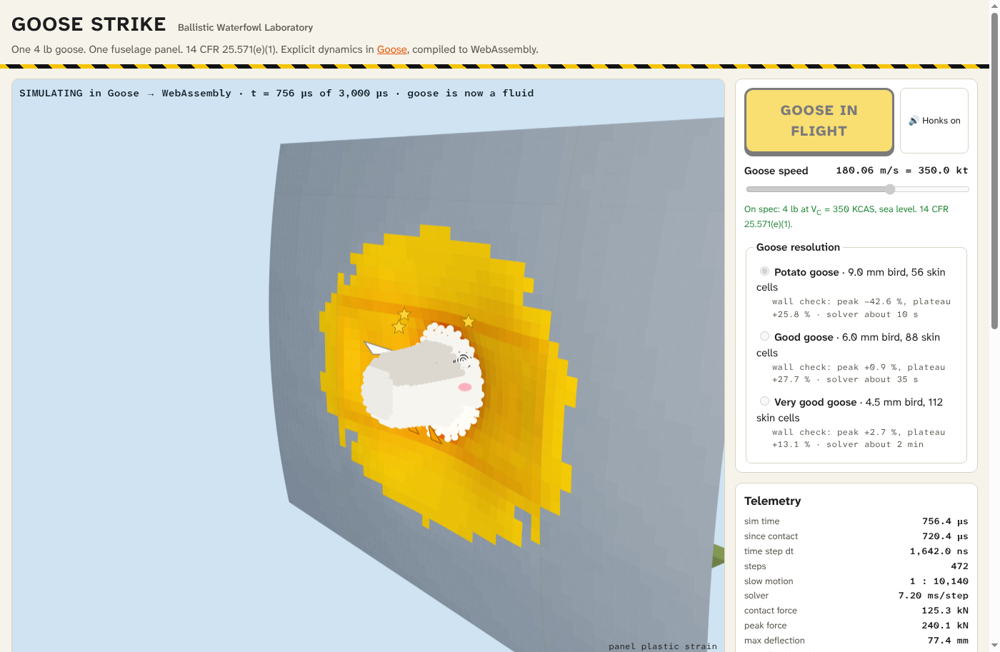

# goosestrike

A 4 lb bird hits a stiffened aluminium fuselage panel at V<sub>C</sub>, the load case of 14 CFR 25.571(e)(1).
The solver is explicit dynamics, written in [Goose](https://github.com/aardappel/goose), compiled through C to WebAssembly.
If the browser has WebGPU, the same solver runs on the GPU: WGSL compute shaders do each time step, and Goose makes the set-up and controls the GPU.
The GPU solver runs finer meshes in seconds, and the page lets you change the bird speed and the skin thickness.
It runs in a browser page that shows the bird as a cartoon goose, shows the Goose code that runs, and exports the strike as an animated GIF.



Run it:

```sh
python3 -m http.server -d web 8000
# then open http://localhost:8000/
```

A local server has no `/shared/kowalski.css`, so the page shows without the fonts and colours of the site.
The repository has the built `web/strike.wasm` and `web/strike-gpu.wasm`, so the page needs no build step.
The page uses the GPU solver if the browser has WebGPU and the GPU solver starts, else the CPU solver. Add `?solver=cpu` to the URL to use the CPU solver.
This is not a certification analysis. The page and this README say where the model is coarse.

## The load case

14 CFR 25.571(e)(1), as amended to Amendment 25-148 ([text at law.cornell.edu](https://www.law.cornell.edu/cfr/text/14/25.571)):

> (e) Damage-tolerance (discrete source) evaluation. The airplane must be capable of successfully completing a flight during which likely structural damage occurs as a result of—
> (1) Impact with a 4-pound bird when the velocity of the airplane relative to the bird along the airplane's flight path is equal to V<sub>C</sub> at sea level or 0.85V<sub>C</sub> at 8,000 feet, whichever is more critical;

| Quantity | Value | Source |
|---|---|---|
| Bird mass | 4 lb = 1.81436948 kg | the rule, and 1 lb = 0.45359237 kg |
| V<sub>C</sub> | 350 KCAS | 14 CFR 25.1505: V<sub>MO</sub> must not be greater than V<sub>C</sub>. The A320 has V<sub>MO</sub> = 350 kt ([EASA TCDS EASA.A.064](https://www.easa.europa.eu/en/document-library/type-certificates/aircraft-cs-25-cs-22-cs-23-cs-vla-cs-lsa/easaa064-airbus-a318-a319-a320), Issue 62, Section 1 A320). Thus 350 KCAS is the lowest V<sub>C</sub> that the rule allows for this aeroplane. |
| Impact speed | 180.06 m/s | 350 KCAS = 350 KTAS at sea level ISA. 1 kt = 1852/3600 m/s. |
| Altitude | sea level | 0.85 V<sub>C</sub> at 8000 ft is about 0.96 V<sub>C</sub> true airspeed, so the sea-level case is more critical. |
| Direction | normal to the skin, at the middle of the panel | an idealized worst case |

## The bird: physics and costume

The physics bird is the standard substitute bird of bird strike analysis.
The cartoon goose is only paint on it.

| Physics | Value | Source |
|---|---|---|
| Shape | cylinder with hemispherical ends, length/diameter = 2 | Heimbs 2011, Perdikoulis et al. 2021 |
| Size | diameter 113.1 mm, length 226.2 mm | from the mass and the density |
| Material | gelatin with 10 % porosity, 950 kg/m³ | Perdikoulis et al. 2021, after Barber et al. |
| Equation of state | Tait for water: p = (ρ<sub>0</sub>c<sub>0</sub>²/γ)((ρ/ρ<sub>0</sub>)<sup>γ</sup> − 1), c<sub>0</sub> = 1480 m/s, γ = 7, no tension (p ≥ 0) | Heimbs 2011 |

The costume (white feathers, eyes, beak, wings, feet, head tuft and blush) follows the particles, but it has no mass and no effect on the result.
The flight before contact is a cartoon. The simulation starts with the nose 2 mm plus half a particle spacing from the skin.

## The panel

The geometry is a representative assumption, not a drawing of a real aeroplane.

| Part | Value |
|---|---|
| Fuselage radius | 1.975 m (A320 class) |
| Panel | 1.0668 m along the fuselage (two 533 mm frame bays) × 0.760 m around it (four 190 mm stringer bays) |
| Edges | clamped, on the next frames and stringers |
| Skin | 2024-T3, 1.6 mm (the page can set 0.8 mm to 3.2 mm) |
| Stringers | 4 Z sections, 7075-T6, web 25.4 mm, flange 15 mm, 1.6 mm |
| Frames | 2 Z sections, 7075-T6, web 76.2 mm, flange 25 mm, 1.6 mm |

Material data, from ASM Aerospace Specification Metals (data sheets for 2024-T3 and 7075-T6 sheet, as published on MatWeb):

| | ρ (kg/m³) | E (GPa) | ν | yield (MPa) | ultimate (MPa) | elongation |
|---|---|---|---|---|---|---|
| 2024-T3 | 2780 | 73.1 | 0.33 | 345 | 483 | 18 % |
| 7075-T6 | 2810 | 71.7 | 0.33 | 503 | 572 | 11 % |

The plasticity is bilinear: a straight line from yield to the ultimate stress at the elongation.
An element erodes when its plastic strain reaches the elongation less the elastic strain at the ultimate stress: 17.3 % for 2024-T3 and 10.2 % for 7075-T6.

## The method

All of it is in `sim/strike.goose`. Units are SI.

- Bird: smoothed particle hydrodynamics (SPH). Cubic spline kernel, h = 1.2 × particle spacing, continuity equation for the density, Monaghan artificial viscosity (α = 1, β = 2).
- Panel: Belytschko-Lin-Tsay 4-node shells with 5 Gauss points through the thickness. J2 plasticity with linear hardening and the plane-stress return of Simo and Taylor. Stiffness hourglass control. Lumped masses.
- Contact: penalty. Each particle pushes on its nearest shell element, with a stiffness of 0.1 × reduced mass / dt².
- Time: central differences. The stable time step comes from the smallest shell element and from the SPH sound speed (CFL 0.25 for SPH, 0.9 for the shells).
- Memory: all state is fixed-size global arrays in static data. The time loop allocates nothing.

The energy balance closes: bird kinetic energy + bird internal energy + panel kinetic energy + panel internal work stays within 0.4 % of the initial kinetic energy in all runs below.

## Accuracy: the rigid wall check

Wilbeck (1978) gives two pressures at the centre of a soft body that hits a rigid wall:

- the Hugoniot shock pressure at first contact, P<sub>H</sub> = ρ<sub>0</sub> U<sub>s</sub> v. Here U<sub>s</sub> comes from the jump conditions with the same Tait equation of state.
- the stagnation pressure of the steady flow after the shock, P<sub>s</sub> = ½ ρ<sub>0</sub> v².

At 180.06 m/s, P<sub>H</sub> = 314.4 MPa (U<sub>s</sub> = 1838 m/s) and P<sub>s</sub> = 15.40 MPa.
The solver measures the force on a disc of radius D/8 (14.2 mm) at the impact centre.
"Peak" is the maximum. "Plateau" is the mean from 0.25 to 0.75 of the squash-up time L/v = 1260 µs.

| Bird spacing | Particles | Peak (MPa) | Peak vs P<sub>H</sub> | Plateau (MPa) | Plateau vs P<sub>s</sub> | Impulse / m v | Energy balance |
|---|---|---|---|---|---|---|---|
| 9 mm | 2560 | 180.5 | −42.6 % | 19.37 | +25.8 % | 1.0079 | 0.9997 |
| 6 mm | 8760 | 317.4 | +0.9 % | 19.67 | +27.7 % | 0.9955 | 1.0006 |
| 4.5 mm | 20902 | 322.9 | +2.7 % | 17.42 | +13.1 % | 0.9935 | 1.0000 |
| 3.5 mm | 44412 | 350.1 | +11.3 % | 15.90 | +3.2 % | 0.9921 | 1.0000 |

The impulse is m v within 1 %, and the energy balance closes within 0.1 %.
The plateau converges to P<sub>s</sub> as the spacing decreases, to +3.2 % at 3.5 mm.
The peak converges less well. At 9 mm, the smoothing length (10.9 mm) smears the shock, and the peak is 43 % low.
At 6 mm and 4.5 mm the peak is within 3 %, and at 3.5 mm it is 11 % high.
The peak is the maximum of one time step on a 14 mm disc, so it is noisy. Use it as an order-of-magnitude check, and the plateau as the convergence check.
These numbers come from `validate`, the native build of the same solver (see below). The page runs the same check in the browser with the "Run the wall check" button.

## The panel result

Impact at 180.06 m/s, run to 3 ms. Bird kinetic energy at the start: 29.41 kJ.

| Bird spacing | Skin cells along the fuselage | Shells | Peak contact force | Max deflection | Eroded skin shells | Eroded stiffener shells | Panel work | Hourglass part | Worst energy balance error |
|---|---|---|---|---|---|---|---|---|---|
| 9 mm | 56 | 3088 | 240.1 kN | 150.8 mm | 0 | 36 | 18.53 kJ | 0.34 kJ | 0.32 % |
| 6 mm | 88 | 7712 | 229.3 kN | 152.1 mm | 8 | 62 | 18.92 kJ | 0.25 kJ | 0.20 % |
| 4.5 mm | 112 | 12960 | 209.1 kN | 152.9 mm | 25 | 152 | 19.29 kJ | 0.27 kJ | 0.11 % |
| 3.5 mm | 144 | 20560 | 203.7 kN | 228.1 mm | 249 | 191 | 18.47 kJ | 0.38 kJ | 0.08 % |

The shell size is about 2.1 bird spacings. The panel mass is 5.05 kg.

From 9 mm to 4.5 mm, the deflection changes by less than 2 %.
The skin damage does not converge: at 9 mm, no skin element reaches the failure strain, but at 6 mm and 4.5 mm some do.
At 3.5 mm, 249 skin elements erode, a hole opens in the skin, and the deflection is 50 % larger.
Element erosion depends on the element size, so a tear prediction needs a failure model calibrated to the mesh. This model has none.
Thus the 3.5 mm result does not show that the real skin tears. It shows that the erosion model is the coarse part of this model.
The stringers and frames fail locally at all four meshes.
The 3.5 mm row comes from the native build. The GPU solver gives 227.9 mm to 228.3 mm, 248 to 260 eroded skin shells and 185 to 189 eroded stiffener shells in 5 runs.
The rule accepts damage. It asks that the aeroplane completes the flight with it, and that needs a residual strength analysis, which this project does not do.

## The browser trade

The GPU solver is 18 to 128 times faster than the CPU solver, and the speed-up increases with the mesh size.
The page offers three meshes on the CPU and four meshes on the GPU.
The solver time per step grows with the particle count, and the stable time step decreases with the element size.

| Page preset | Bird spacing | Skin cells | Bird particles | Shell elements | Steps to 3 ms |
|---|---|---|---|---|---|
| Potato goose | 9 mm | 56 | 2560 | 3088 | 1774 |
| Good goose | 6 mm | 88 | 8760 | 7712 | 2679 |
| Very good goose | 4.5 mm | 112 | 20902 | 12960 | 3594 |
| Excellent goose (GPU only) | 3.5 mm | 144 | 44412 | 20560 | 4652 |

The table below gives the solver time per step in Node 24 on an Apple M5.
The CPU column is the wasm on one core. The GPU column is the same solver in WebGPU (Dawn on Metal, the `webgpu` package).
The benchmark ran 300 steps on each mesh, the CPU first and then the GPU.
The machine had a load average of 25 from other work, thus the CPU times are higher than on an idle machine.

| Bird spacing | CPU time per step | GPU time per step | Speed-up |
|---|---|---|---|
| 9 mm | 18.2 ms | 0.99 ms | 18 |
| 6 mm | 76.7 ms | 1.51 ms | 51 |
| 4.5 mm | 146 ms | 1.64 ms | 89 |
| 3.5 mm | 288 ms | 2.25 ms | 128 |

On an idle machine, the CPU times were 5.7 ms, 13.1 ms and 31.3 ms per step for the first three meshes. The native build is about 1.6 times faster than the wasm.

The table below gives the time of the full panel run on the page, in Chrome 156 on the same machine, with a high load from other work.
The two GPU columns are two different runs. On the CPU, the page also does the steps one phase at a time for the code view.

| Page preset | CPU | GPU, run 1 | GPU, run 2 |
|---|---|---|---|
| Potato goose | 65 s | 0.9 s | 2.0 s |
| Good goose | 301 s | 3.6 s | 5.6 s |
| Very good goose | 1085 s | 9.7 s | 12.3 s |
| Excellent goose | not available | 20.9 s | 56.7 s |

On the GPU, the 2D canvas renderer limits the page at fine meshes. At 3.5 mm, the page shows 7 to 15 frames per second, and the solver waits for the frames.

Only Chrome 156 on macOS (Metal) was tested, in headless mode. Other browsers with WebGPU possibly work, but they were not tested. Without WebGPU, the page uses the CPU solver.

The 9 mm mesh is the fast default on the CPU. The trade: its peak pressure is 43 % low, its plateau is 26 % high, and it shows no skin erosion. But its deflection is within 1.5 % of the 4.5 mm result, and its peak force is 15 % higher.

## The page

- The code view shows `web/strike.goose`, the copy of `sim/strike.goose` that `build.sh` writes.
  The page runs each time step in five phases, one call of the wasm export `step_phase` each: time step, SPH bird, shells (with plasticity and erosion), contact and integration.
  `run_phase` in the source has the five phases. The lit lines are the phase that ran last, as `step_phase` returns it. The source scrolls to that phase, at most once a second.
  A test checks that the phases one at a time give the same result as whole steps.
  On the GPU, the kernels of `web/strike.wgsl` do the five phases, and the code view says so. No line is lit.
- The skin thickness control sets the skin of the next run, from 0.8 mm to 3.2 mm. The stringers and frames keep their 1.6 mm. The preset values on the page are for the 1.6 mm skin only.
- The telemetry shows the solver (GPU or CPU), the solver time per step and the frame rate.
- "Export GIF" saves the last run as an animated GIF, 480 px wide: about ten frames a second of the approach, then one frame each 25 µs of simulated time.
  Each frame has a caption with the time and the colour bar. The encoder is `web/gif.mjs` (median cut palette, LZW), with no dependency.
- The colour maps are continuous ramps, interpolated in OKLab: plastic strain on a square-root scale from the bare metal (0 %) to 18 %, so that the first yield shows, and bird pressure on a log scale from 0.1 MPa to 400 MPa.
- The look (fonts, palette, interaction rules) is that of [teoyujie.org](https://teoyujie.org): the page links the site's shared stylesheet `/shared/kowalski.css`. `web/style.css` has only the rules of this tool.

## Goose on WebAssembly

Goose has no wasm port yet (its `docs/design/wasm.md` is a proposal).
The C that Goose writes compiles with Emscripten, with one risk: Goose reserves a large address range (2 GiB by default) for each data stack, with a guard gap behind it that stops a stack overflow.
WebAssembly linear memory has no reservation and no guard pages. Emscripten's `mmap` allocates the full size, and `mprotect` does nothing.

The handling:

1. The solver keeps all state in static global arrays. The generated C of the time loop (`step_once`, `step_phase` and the functions they call) has no data-stack use. You can check this: in the code of the program, `gen/strike.c` uses `->top` only in `gs_init_globals`.
2. `gs_init_globals` builds each zeroed global array in a data-stack temporary and copies it. The largest temporary is `esig`, 24000 × 15 × 8 B = 2.88 MB, and each temporary is released before the next one.
3. Thus `build.sh` sets `GS_STACK_RESERVE` to 4 MiB and the guard gap to 64 KiB. If a later change makes a larger global array, raise the reserve.

The same is true for `gen/gpu.c`: it uses `->top` only in `gs_init_globals`, and its largest global array is also `esig`.

## Goose on WebGPU

The GPU solver has three parts:

| File | Language | What it does |
|---|---|---|
| `sim/gpu.goose` | Goose | The host. It calls `setup` of `strike.goose`, copies the bird and the panel to GPU buffers, makes a bind group for each kernel, records the time steps and reads back the results. It imports `strike.goose`, so the getters of the CPU solver give the GPU results. |
| `sim/gpu.c` | C | The WebGPU calls, through `webgpu.h`. Goose cannot make the `webgpu.h` descriptors (they hold pointers) or give a callback, so `sim/gpu.goose` calls these C functions as `extern fn`. This file has no solver logic. |
| `web/strike.wgsl` | WGSL | 11 compute kernels. One time step is 10 kernels in sequence: the five phases of `run_phase` in `strike.goose`, and a reduction that sums the energies and the forces, advances the time and computes the next time step. |

The WebGPU implementation is Emscripten's own port, `--use-port=emdawnwebgpu` (from the Dawn releases). The page gives the GPU device to the wasm module, so no C code waits for a promise.

The GPU solver is a port of the CPU solver, with these differences:

- It uses f32, because WGSL has no f64. The CPU solver uses f64. The plasticity return stops at a tolerance of 1e-6, not 1e-12.
- The SPH forces are a gather: each particle sums the forces from its neighbours, so each pair is computed two times. The CPU solver computes each pair one time.
- The shell and contact forces on the nodes are sums with atomic operations, so the sequence of the additions changes from run to run. Thus the GPU results are not bit-for-bit repeatable.
- The page keeps two batches of steps on the GPU. Thus the GPU does the next batch while the page reads the results of the last one.

`test/gpu.test.mjs` runs the 9 mm panel to 3 ms on the GPU and on the CPU, and compares them. The tolerances are about 10 times the differences on Metal:

| Value | Tolerance | Difference on Metal |
|---|---|---|
| Max deflection, at each step | 0.1 mm | 0.013 mm |
| Peak contact force | 1 % | less than 0.001 % |
| Max deflection, max plastic strain, panel work | 0.1 mm, 1 %, 1 % | 0.0001 mm, 0.03 %, 0.003 % |
| Eroded shells (all, and skin) | 2 elements | 0 |
| Steps to 3 ms | 1 % | 0 |

The test also runs the rigid wall on the GPU: the impulse is m v within 2 %, and the energy balance closes within 1 %.

The GPU and the CPU agree less well on the plateau of the rigid wall check. The centre sensor force changes by about 20 % from step to step, so small differences change its mean.

| Bird spacing | Peak vs P<sub>H</sub>, CPU / GPU | Plateau vs P<sub>s</sub>, CPU / GPU | Impulse / m v, CPU / GPU |
|---|---|---|---|
| 9 mm | −42.6 % / −42.6 % | +25.8 % / +25.8 % | 1.0079 / 1.0079 |
| 6 mm | +0.9 % / +0.9 % | +27.7 % / +25.8 % to +26.5 % | 0.9955 / 0.9957 |
| 4.5 mm | +2.7 % / +2.7 % | +13.1 % / −0.7 % | 0.9935 / 0.9936 |
| 3.5 mm | +11.3 % / +11.3 % | +3.2 % / −0.2 % to 0.0 % | 0.9921 / 0.9920 |

The peak and the impulse agree. The plateau agrees at 9 mm and 6 mm, but at 4.5 mm and 3.5 mm the GPU plateau is lower. The cause is not known. Thus the page shows the plateau of the native CPU solver for each preset.

## Build

The build needs the Goose compiler and Emscripten. On NixOS, these commands work (no compiler needs to be on the PATH):

```sh
# 1. the Goose compiler, at the commit that this repository uses
git clone https://github.com/aardappel/goose ../goose
git -C ../goose checkout a108677d300cb0e8bbb842c35a353abe67a20c6c
( cd ../goose && nix shell nixpkgs#cmake nixpkgs#clang nixpkgs#lld nixpkgs#gnumake --command \
    bash -c 'cmake -B build -DCMAKE_BUILD_TYPE=Release -DCMAKE_C_COMPILER=clang -DCMAKE_CXX_COMPILER=clang++ && cmake --build build -j16' )

# 2. the C (gen/), the wasm (web/strike.mjs, web/strike.wasm, web/strike-gpu.mjs, web/strike-gpu.wasm)
#    and web/strike.goose, with Emscripten 6.0.9. Emscripten downloads its emdawnwebgpu port.
nix shell nixpkgs#emscripten --command env GOOSE=$PWD/../goose/build/goose ./build.sh

# 3. the native validation program
( cd sim && nix shell nixpkgs#clang --command ../../goose/build/goose build -o ../build/validate validate.goose )
build/validate 9000 6000 4500 3500       # rigid wall, bird spacings in µm
build/validate --panel 9000 6000 4500    # the panel
```

Add `--csv` to `validate` to print the time history.

`gen/strike.c` and `gen/strike.h` are the C that the Goose compiler generates from `sim/strike.goose`. They are C, not C++, and nobody edits them by hand.
They are in the repository so that you can read the code that Emscripten compiles to `web/strike.wasm`.
`gen/gpu.c` and `gen/gpu.h` are the same for `sim/gpu.goose`.
`build.sh` writes them, and writes `gen/sha256sums` with the SHA-256 of the Goose sources, `sim/gpu.c`, the C and the two wasm files.

## Tests

```sh
nix shell nixpkgs#nodejs --command npm ci
nix shell nixpkgs#nodejs --command npm test
```

The tests (`test/strike.test.mjs`) load the committed `web/strike.wasm` in Node and check:

- that the C in `gen/` and the two wasm files come from the current sources (the sums in `gen/sha256sums`), and that `web/strike.goose` is the same as `sim/strike.goose`,
- the load case constants and the Wilbeck reference pressures,
- the rigid wall impulse (m v within 2 %) and energy balance (within 1 %),
- the panel energy balance (within 1 %), the panel mass, and that a new set-up gives the same result,
- that the phases one at a time (`step_phase`) give the same result as whole steps (`advance`).

`test/gpu.test.mjs` compares the GPU solver with the CPU solver (see "Goose on WebGPU"). It gets WebGPU in Node from the `webgpu` package (Dawn), a development dependency.
If there is no GPU adapter, these tests skip, but with `GOOSESTRIKE_GPU=1` they fail.

`test/gif.test.mjs` checks that the GIF palette keeps a colour ramp next to a large light background.

CI runs the same tests on each push. CI installs lavapipe, a Vulkan driver that runs on the CPU, and sets `GOOSESTRIKE_GPU=1`. Thus CI also runs the GPU tests.

## Sources

- 14 CFR 25.571(e)(1) and 25.1505. Electronic Code of Federal Regulations, through Amendment 25-148.
- EASA Type-Certificate Data Sheet EASA.A.064 (Airbus A318, A319, A320, A321), Issue 62.
- R. L. Wilbeck, *Impact behavior of low strength projectiles*, AFML-TR-77-134, 1978 (DTIC ADA060423).
- S. Heimbs, Computational methods for bird strike simulations: a review, *Computers & Structures* 89 (2011) 2093–2112, doi:10.1016/j.compstruc.2011.08.007.
- C. Perdikoulis, E. Theotokoglou, G. Giannopoulos, Bird strike virtual testing simulations and results, for preliminary airframe design structural optimization, WCCM-ECCOMAS 2020 (2021).
- ASM Aerospace Specification Metals, data sheets for aluminium 2024-T3 and 7075-T6.

## Licence

MIT (see `LICENSE`), for the code of this repository.
Goose is Apache-2.0. This repository does not include Goose source, but the generated `gen/strike.c` and `web/strike.wasm` contain the Goose runtime that the compiler puts in its output. Thus `web/GOOSE-LICENSE.txt` has the Goose licence.
`web/strike-gpu.mjs` and `web/strike-gpu.wasm` contain code of Emscripten's emdawnwebgpu port. `web/WEBGPU-LICENSE.txt` has its BSD licences.
